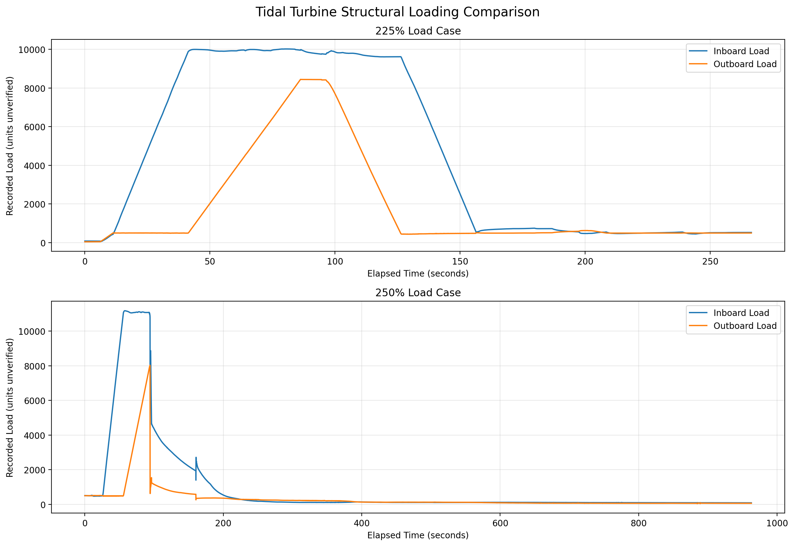
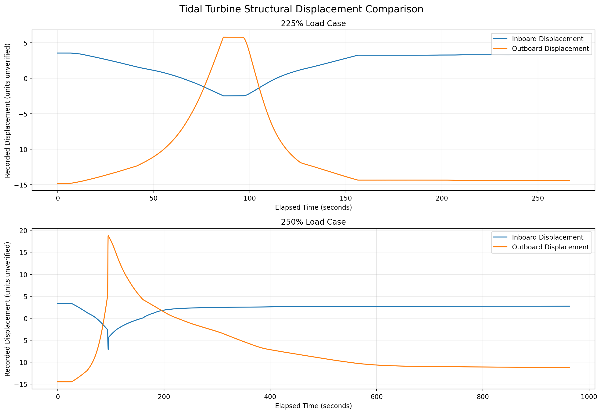
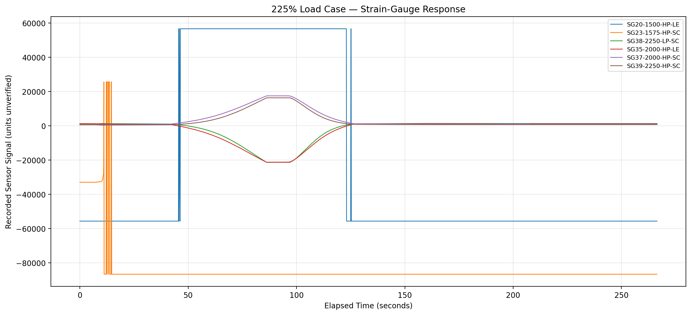
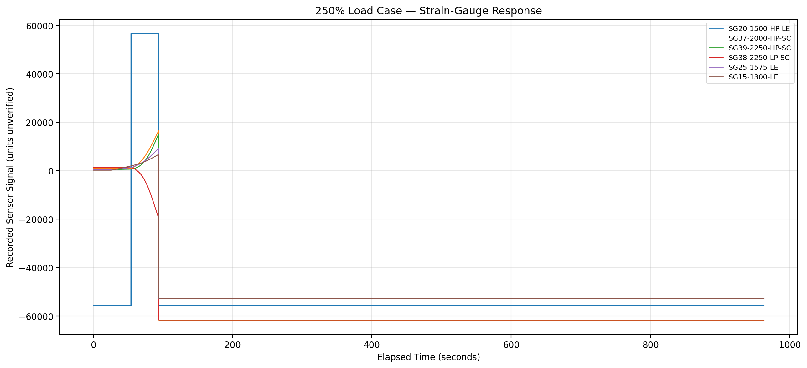
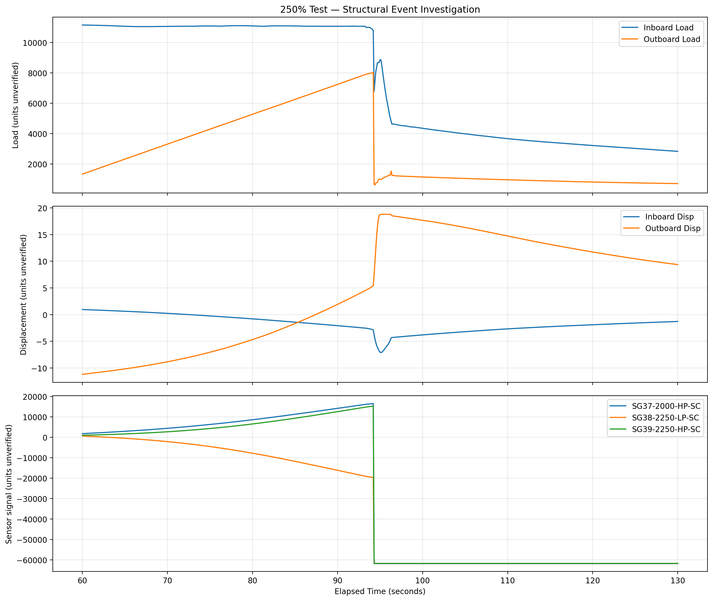

<p align="center"></p>

<h1 align="center">Marine Tidal Turbine | Structural Performance Analytics</h1>
<p align="center"><strong>Independent engineering analytics portfolio </strong></p>
<p align="center">
  
  
  
  
</p>

<p align="center"><a href="#executive-summary">Overview</a> · <a href="#engineering-results">Results</a> · <a href="#dashboard-gallery">Dashboards</a> · <a href="#repository-guide">Files</a> · <a href="#reproduce-the-analysis">Reproduce</a></p>

---

## Executive summary

This independent project analyzes structural loading, displacement, strain-gauge response, and measurement quality in **225% and 250% tidal turbine blade load-case tests**. Python time-series analysis and SQLite window functions identified a prominent multi-channel measurement event at **94.3 seconds** during the 250% test.

**Engineering boundary:** the observed event may reflect a structural or test-system response. Its physical cause has **not** been verified, and this analysis does **not** establish a confirmed blade failure. Original measurement units remain unverified; root moment is an *uncorrected* measurement channel.

## At a glance

| 12,295 | 2 | 29 | 94.3 s |
|:---:|:---:|:---:|:---:|
| Measurement records | Load-case tests | Strain-gauge channels per test | Key event in 250% test |

## Engineering results

### Load-case comparison

| Measurement | 225% load case | 250% load case |
|---|---:|---:|
| Records | 2,665 | 9,630 |
| Maximum inboard load | 10,022.414 | 11,174.147 |
| Maximum outboard load | 8,447.801 | 8,023.323 |
| Maximum **uncorrected** root moment | 127.332 | 128.497 |

*Values are presented as recorded; engineering units require confirmation against source documentation.*

### Significant measurement event — 250% load case

At **94.3 s**, consecutive samples showed simultaneous changes in load and uncorrected root moment:

| Channel | Single-sample change |
|---|---:|
| Inboard load | −3,979.990 |
| Outboard load | −7,347.755 |
| Uncorrected root moment | −85.629 |

Python and SQLite `LAG()`-based analyses independently flagged this event. Strain-gauge channels **SG37, SG38, and SG39** shifted to persistent negative readings near the event; sensor saturation or acquisition behavior is a possible explanation, **not a confirmed diagnosis**.

## Dashboard gallery

### 01 · Structural loading


### 02 · Structural displacement


### 03 · Strain response — 225% load case


### 04 · Strain response — 250% load case


### 05 · Event investigation — 250% load case


## Repository guide

```text
.
├── README.md                         Project overview and gallery
├── assets/                           Dark-red / black visual identity
├── notebooks/                        Clean executable analysis notebook
├── dashboards/                       Five engineering visualizations
├── reports/                          Engineering findings and six-page PDF
├── sql/                              SQL queries and exported results
├── docs/                             Source attribution and reproduction guide
├── requirements.txt                  Python dependencies
└── publication_manifest.json         SHA-256 file inventory
```

**Open the work:** [Analysis notebook](notebooks/Project_4_Marine_Tidal_Turbine_Public.ipynb) · [Engineering PDF](reports/Project_4_Engineering_Report.pdf) · [Engineering findings](reports/Project_4_Engineering_Findings.md) · [SQL event detection](sql/structural_event_detection.sql)

## Reproduce the analysis

The **22 original analysis cells** were reported to execute successfully in a fresh Google Colab runtime with the original workbooks available. The public notebook has saved outputs removed. Reproduction requires the original source files, a mounted Google Drive, and the documented project folder structure.

1. Read the [reproducibility guide](docs/REPRODUCIBILITY.md).
2. Obtain the three source Excel workbooks from the [original repository](https://mhkdr.openei.org/submissions/738).
3. Place them in `Project_4_Tidal_Turbine/data/` in Google Drive, install `requirements.txt`, and run the [notebook](notebooks/Project_4_Marine_Tidal_Turbine_Public.ipynb) in order.

## Data source, attribution, and limitations

Source: *TEAMER: Structural Tidal Turbine Blade Test to Failure* (Murdy et al., 2026), [Marine and Hydrokinetic Data Repository](https://mhkdr.openei.org/submissions/738). The dataset is attributed under **CC BY 4.0**; see [source details and license](docs/DATA_SOURCE.md). Original Excel files are **not included** in this repository.

- Measurement units are not independently verified.
- Root moment values are uncorrected.
- Several strain-gauge channels show constant or unusual readings.
- Test durations differ; direct comparisons need context.
- The cause of the 94.3-second event is unverified; physical blade failure is not established.

---
<p align="center"><strong>ENGINEERING ANALYTICS · DATA QUALITY · TEST INVESTIGATION</strong></p>
